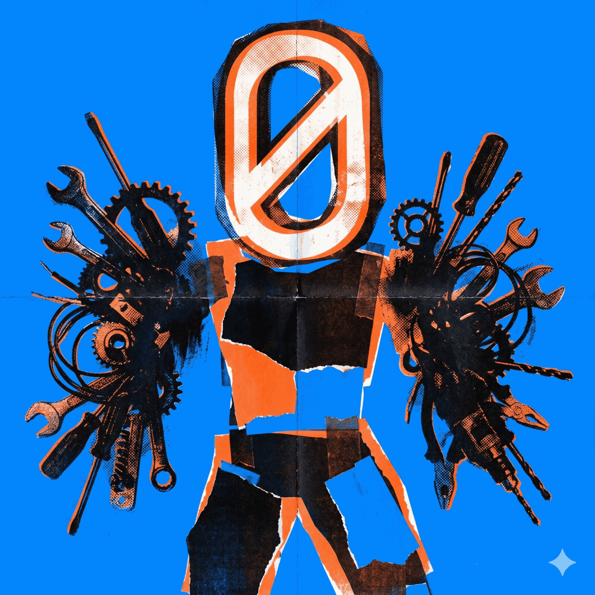

# t0-agents

<p align="center">
  
</p>

The Pythonic agentic framework for [TensorZero](https://www.tensorzero.com/).
Build LLM agents that discover and execute tools through
[MCP](https://modelcontextprotocol.io/) (Model Context Protocol), while
TensorZero handles inference routing, episode tracking, and
ClickHouse-backed observability for you.  Two surfaces, one engine:
`t0_agents.glow` for the four-line decorator path, the canonical
`Agent` surface for the moments you need every escape hatch.

> **Status**: Alpha. APIs are stabilising. Pinned against `tensorzero >= 2026.4.0` and `fastmcp >= 3.2.3`.

## Four lines, one agent.

```python
from t0_agents.glow import App
app = App(t0=t0)

@app.agent("tutor")
async def tutor(query: str) -> str:
    """An English tutor that explains grammar like you're 12."""

print(await tutor("How do I say hello in formal Japanese?"))
```

The docstring is the system prompt.  The return annotation picks the
[`OutputMode`](docs/output-modes.md).  `await tutor(...)` returns the
unwrapped string directly.  Install with the extra:
`pip install 't0-agents[glow]'`.  Full tour at
[`docs/glow/`](docs/glow/index.md).

## When you need the controls — drop down to Agent.

```python
from t0_agents import Agent, AgentConfig

# Construct once, run many.
agent = Agent(AgentConfig(
    name="assistant",
    function_name="agent",
    middleware=[TimingMiddleware(), MyGuardrails()],   # Starlette-style chain
), t0=t0, tool_provider=client)

# invoke(...) returns a Run[T] — the first-class invocation handle.
run = agent.invoke("Plan my trip to Lisbon under $1500.")

# Iterate live AgentEvent stream:
async for event in run.events():
    ...

# Cooperative cancellation:
await run.cancel()

# Await the terminal AgentResult:
result = await run                      # episode_id, inference_ids, cost
forked = await run.fork("Make it Madrid instead.")

# Polymorphic outputs — typed end-to-end.
from t0_agents import StructuredOutput
from pydantic import BaseModel

class Customer(BaseModel):
    name: str
    email: str

extractor = Agent(AgentConfig(
    name="extractor",
    function_name="extract_customer",
    output=StructuredOutput(Customer),
), t0=t0)
parsed = (await extractor.invoke("Sarah <sarah@example.com>")).value
parsed.email                            # statically typed Customer
```

Glow compiles down to exactly this `Agent`.  Every glow wrapper
exposes `_agent` — the same v1.0 surface — for the moments the
decorator is in your way.  See
[`docs/glow/escape-hatch.md`](docs/glow/escape-hatch.md).

Each axis pairs with one chapter of the docs:
[Run](docs/run.md) · [Middleware](docs/middleware.md) ·
[Output Modes](docs/output-modes.md).  Multi-agent topologies are
built directly from these primitives plus plain `asyncio` — see the
runnable patterns under
[`examples/agent/12_concurrency/`](examples/agent/12_concurrency/)
and [`examples/glow/`](examples/glow/), documented in
[Multi-Agent](docs/multi-agent.md).

## Why t0-agents

Most agentic frameworks try to be everything at once.  They reimplement
inference routing, prompt versioning, tool discovery, observability and
human-in-the-loop — and as a result they reimplement most of those
things badly.

t0-agents takes the opposite bet.  Two upstream projects already solved
the hard parts:

- **TensorZero** owns inference: gateway routing, provider fallback,
  prompt versions, episode IDs, ClickHouse analytics, A/B testing.
- **FastMCP** (Model Context Protocol) owns tools: dynamic discovery,
  schema evolution, sticky-session HTTP transport, the elicitation
  primitive for human-in-the-loop.

t0-agents is the thin glue between them.  The `mcp/` submodule fits in
~100 lines of production code; everything above it — `Agent`,
`Run[T]`, `Middleware`, `OutputMode[T]`, memory, guardrails,
streaming, multi-agent, HTTP serving, the terminal TUI, the test
harness, and the `glow` decorator skin — is opt-in.

## Install

You pay only for what you use.  Base = adapter + loop + `Agent` +
`InMemoryMemory` + guardrails + streaming + composition + testing.
Everything that pulls a heavier third-party dependency lives behind an
optional extra.

```bash
# Base install (no Docker, no FastAPI, no SQLite).
pip install t0-agents

# Adds pydantic + the @app.agent decorator surface (the four-line path).
pip install 't0-agents[glow]'

# Adds aiosqlite for cross-process memory persistence.
pip install 't0-agents[memory-sqlite]'

# Adds FastAPI + Uvicorn + Pydantic + sse-starlette for HTTP serving.
pip install 't0-agents[serve]'

# Adds Typer + Rich on top of [serve]; registers the `t0-agents` script.
pip install 't0-agents[cli]'

# Adds Pydantic for StructuredOutput[M].
pip install 't0-agents[pydantic]'

# Combine extras as needed:
pip install 't0-agents[glow,memory-sqlite,serve,pydantic]'
```

Or with [`uv`](https://docs.astral.sh/uv/):

```bash
uv add t0-agents                                   # base
uv add 't0-agents[glow,memory-sqlite,cli,pydantic]'   # with extras
```

## Documentation

The public docs are written as a **progressive tour**: each chapter
picks up the tension the previous one left open.  Start at
[the index](docs/index.md) for the full Reading path and Appendices.

**glow — the four-line path** (start here)
- [Getting Started](docs/glow/getting-started.md) — toolless chat, structured outputs by return type, per-call overrides, multi-agent patterns.
- [Streaming and events](docs/glow/streaming-and-events.md) — `FluentRun.events(*selectors)` and the seven typed selectors.
- [Depends and tools](docs/glow/depends-and-tools.md) — value-style injection and sub-agent injection via `Depends(...)`.
- [Typed MCP and guardrails](docs/glow/typed-mcp-and-guardrails.md) — class-based `MCPServer` and `Annotated[T, guardrail(...)]` metadata.
- [Escape hatch](docs/glow/escape-hatch.md) — `wrapper._agent` IS the v1.0 `Agent`; lifespan + drop-down recipes.
- [Known limitations](docs/glow/limitations.md) — what's deferred to v1.1.

**Agent — the canonical, fully-typed surface**
- [Getting Started](docs/getting-started.md) — install and run your first agent.
- [Agent](docs/agent.md) — the declarative `Agent` class and its collaborator Protocols.
- [Run](docs/run.md) — `agent.invoke(msg)` returns `Run[T]`: await, iterate events, cancel, replay, fork.
- [Middleware](docs/middleware.md) — composable cross-cutting concerns (memory, guardrails, cost, retry…).
- [Output Modes](docs/output-modes.md) — chat strings, JSON dicts, Pydantic models, tool-call routers, streaming.
- [Concepts](docs/concepts.md) — pop the hood: what `agent.invoke()` actually does, turn by turn.
- [Elicitation](docs/elicitation.md) — tools that pause to ask humans questions.
- [Memory](docs/memory.md) — remember across turns and across processes.
- [Guardrails](docs/guardrails.md) — constrain what the agent may do.
- [Streaming](docs/streaming.md) — narrate the loop live with typed events, SSE, and WebSocket.
- [Multi-Agent Composition](docs/multi-agent.md) — declarative `sub_agents=[...]`, the LLM-driven path.
- [Serving](docs/serving.md) — `create_app(agent)` and the FastAPI surface.
- [CLI](docs/cli.md) — the `t0-agents` terminal experience.
- [Testing](docs/testing.md) — keep every layer above from regressing.

**Appendices**
- [API Reference](docs/api-reference.md) · [Migration v0.12 → v1.0](docs/migration-v0.12-to-v1.0.md) · [Error Handling](docs/error-handling.md) · [Observability](docs/observability.md) · [Production](docs/production.md) · [Concurrency](docs/concurrency.md) · [Multi-Server](docs/multi-server.md) · [Structured outputs (reference)](docs/structured-outputs.md)

**Guides** — production patterns that compose t0-agents with adjacent tooling:
- [Elicitation in your FastAPI / SSE backend](docs/guides/elicitation-in-api.md)
- [Elicitation in your FastMCP server](docs/guides/elicitation-in-mcp-server.md)

Runnable examples for every chapter live under [`examples/`](examples/) —
[`examples/glow/`](examples/glow/) is the 8-example progressive tour
on top of the decorator surface; [`examples/agent/`](examples/agent/)
has 15 area-by-area examples on top of the canonical `Agent` surface.

## Features

Every layer is opt-in.  The base install gets you the core stack;
heavier extras live behind named installs.

| Capability | What it gives you |
| --- | --- |
| **MCP adapter & loop** | Convert FastMCP tool definitions to TensorZero's inference format, orchestrate the turn-based inference-execute loop, serialize tool results back.  Low-level `run_agent` for full control. |
| **`Run[T]` handles** | `agent.invoke(msg)` returns a `Run` you can `await`, iterate with `.events()`, cancel, replay, fork, and attach feedback to. |
| **Middleware chain** | Memory, guardrails, cost tracking, sub-agent orchestration, JSON retry — all composable middlewares; add your own without forking `core/agent.py`. |
| **`OutputMode[T]` polymorphism** | `ChatOutput`, `JsonOutput`, `StructuredOutput[M]` (Pydantic), `ToolCallOutput`, `StreamingOutput`.  Custom modes (YAML, Instructor, SQLAlchemy) plug in via the same protocol. |
| **glow decorator surface** | FastAPI-style `@app.agent` over the v1.0 primitives.  Docstring = system prompt, return annotation = `OutputMode`, `Depends(...)` for tools and sub-agents, `Annotated[T, guardrail(...)]` for policy as type metadata. |
| **Cross-run memory** | `InMemoryMemory`, `SqliteMemory`, `TensorZeroMemory`, or your own `MemoryProvider`.  Keyed by TensorZero's `episode_id`. |
| **Policy guardrails** | `require_approval`, `max_cost`, `max_tool_calls`, `block_tools` out of the box; custom `Guardrail` Protocol for domain rules.  Every decision is captured on `AgentResult.guardrail_log` for audit. |
| **Multi-agent composition** | Register sub-agents on `AgentConfig.sub_agents` and they become `{name}_ask` tools on the orchestrator's MCP server.  Nested orchestrators, `parent_episode_id` correlation. |
| **HTTP serving** | `create_app(agent)` wraps any agent in a FastAPI app with `/chat`, `/feedback`, `/health`, `/info` — plus `/chat/stream` (SSE) and `/chat/ws` (WebSocket) when `streaming=True`. |
| **Terminal CLI** | `t0-agents run` (interactive streaming TUI), `t0-agents serve` (dev HTTP server), `t0-agents info` (config introspection). |
| **First-class testing** | `MockGateway` + `MockToolProvider` for deterministic unit tests, `EmbeddedGatewayHelper` for real-inference integration tests without Docker, ten `assert_*` helpers. |
| **Observability** | Every run returns the TensorZero `episode_id`, per-turn `inference_ids`, the guardrail log, aggregated cost / usage, and a `response_source` signal. |

## Requirements

- Python 3.11, 3.12, or 3.13
- Docker + Docker Compose (for the TensorZero gateway, required by every example beyond the low-level adapter layer)
- An LLM provider API key (Groq, OpenAI, Anthropic, …) — the default `docker-compose.yml` expects `GROQ_API_KEY` in `.env`

## Development

```bash
uv sync                                     # install dev dependencies
uv run pytest -m "not integration and not embedded"   # offline unit tests
uv run pytest -m integration                # requires docker compose up
uv run pytest -m embedded                   # requires RUN_EMBEDDED_TESTS=1 + provider key
uv run ruff check src/ tests/               # lint
uv run mypy src/                            # type check (strict mode)
```

See [CONTRIBUTING.md](CONTRIBUTING.md) for the full pull-request workflow and the test-mode cheat-sheet.

## License

MIT.  See [pyproject.toml](pyproject.toml) and [CHANGELOG.md](CHANGELOG.md).
