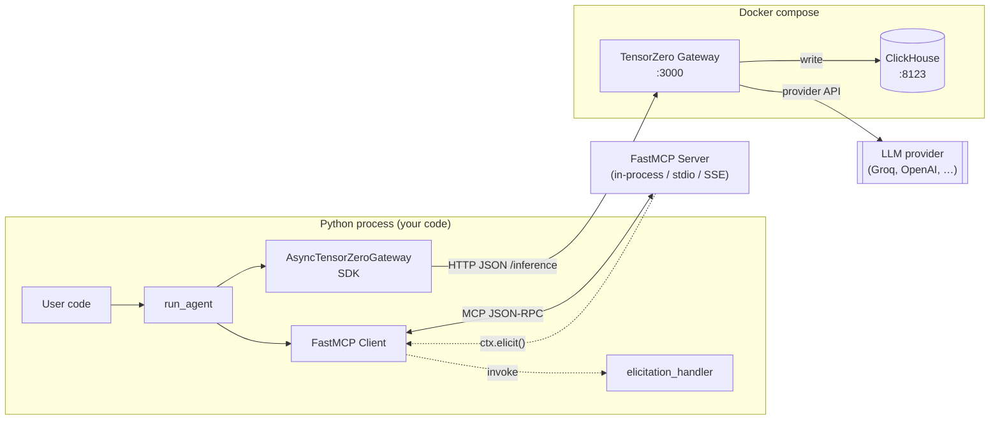
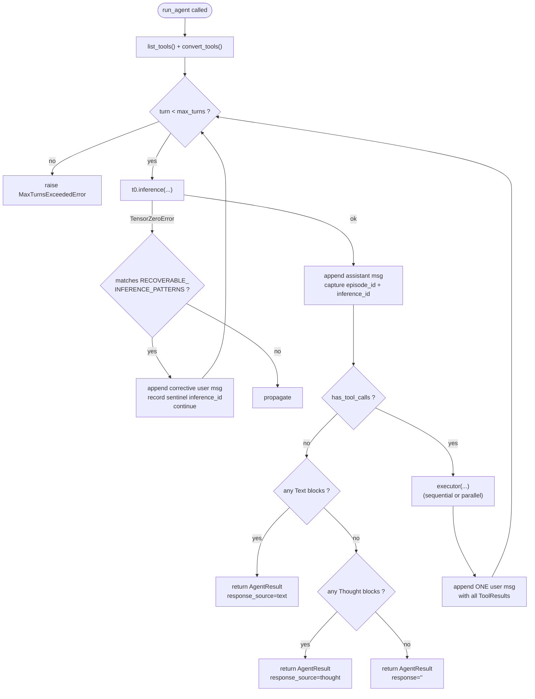
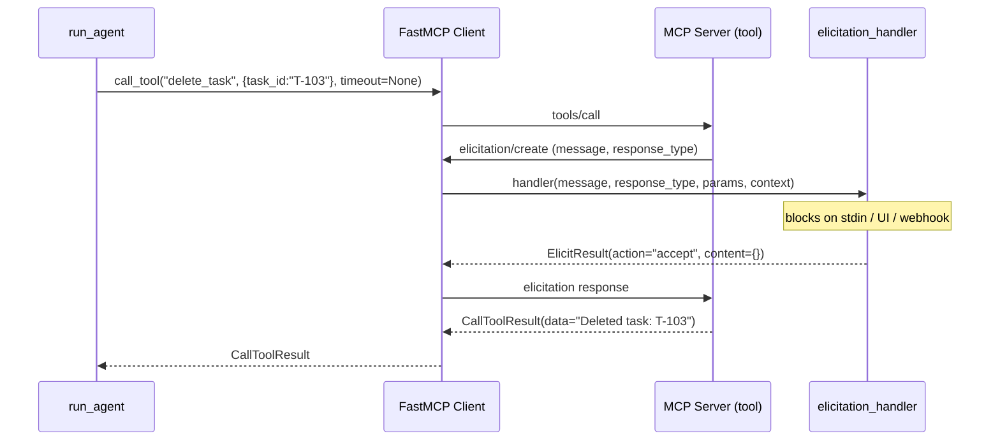

# `t0-agents` Developer Guide

> Internal architectural reference for developers building on top of `t0-agents`.
> Describes the project **as it exists today** — intent, capabilities, data
> flows, customization knobs, and extension seams. Cross-links to the public
> docs under [`../`](../) for end-user material; complements the phase-by-phase
> implementation logs in
> [`approval-and-elicitation-integration-plan/logs/`](approval-and-elicitation-integration-plan/logs/).

---

## 1. Why `t0-agents` exists

`t0-agents` is a thin Python orchestrator that bridges two upstream projects:

- **[TensorZero](https://www.tensorzero.com/)** — a stateless LLM inference
  gateway that routes requests to model providers (Groq, OpenAI, Anthropic,
  …), enforces input/output schemas, and writes every inference to ClickHouse
  for observability and feedback.
- **[FastMCP](https://gofastmcp.com/)** — a Python framework for building and
  consuming **MCP** (Model Context Protocol) servers: tools, resources,
  elicitation, and prompts.

Neither handles the **agent loop**: the cycle of *inference → tool call →
tool execution → feed the result back → infer again*. `t0-agents` is that
orchestrator and nothing more. It:

- Converts FastMCP tool schemas into TensorZero's `additional_tools` payload.
- Drives the loop, appending assistant / user messages in the shape TensorZero
  expects.
- Serializes every tool result back to the `str` that TensorZero's
  `ToolResult.result` field requires.
- Catches tool errors and turns them into `"ERROR: …"` strings so the LLM can
  read them and retry on the next turn instead of crashing the process.

### Anti-scope

The library is intentionally small. It is **not**:

- A multi-agent framework.
- A planner or re-planner.
- Opinionated about prompts — system prompts live in `tensorzero.toml`
  variants, not in `run_agent` parameters.
- A replacement for TensorZero config or FastMCP tool definitions.

Sources: [`README.md`](../../README.md),
[`src/t0_agents/__init__.py:1-15`](../../src/t0_agents/__init__.py),
[`docs/concepts.md`](../concepts.md).

---

## 2. Mental model and vocabulary

| Term | Meaning in this project |
| --- | --- |
| **Gateway** | The TensorZero process (`tensorzero/gateway:2026.4.0`) listening on port `3000`. Receives `inference()` calls over HTTP; writes to ClickHouse. |
| **Function** | A TensorZero chat function defined under `[functions.<name>]` in `tensorzero.toml`. The `function_name` arg to `run_agent` is this name. |
| **Variant** | A `[functions.<f>.variants.<v>]` entry. Pins a model + system prompt + generation params to a function. TensorZero chooses which variant to route to. |
| **Episode** | TensorZero's correlation ID across a conversation. `episode_id` groups multiple inferences in ClickHouse for analytics and feedback. |
| **Inference** | One round-trip to the gateway, producing one `ChatInferenceResponse` and one `inference_id`. |
| **Message** | One element of the conversation history. `role="user"` or `role="assistant"`; `content` is either a string, a list of `Text`/`Thought`/`ToolCall` blocks, or a list of `ToolResult` blocks. |
| **Tool** | A `@mcp.tool`-decorated Python function on a FastMCP server. Converted once per `run_agent` call via `convert_tools`. |
| **ToolCall** | A content block the LLM emits to request tool execution: `name`, `raw_name`, `id`, `arguments`, `raw_arguments`. |
| **ToolResult** | The TensorZero content block the loop appends after executing a tool: `name`, `result` (always a `str`), `id`. |
| **Elicitation** | MCP feature where a tool pauses mid-execution and asks the client for approval or structured input. Handled by an `elicitation_handler` on the FastMCP `Client`. |
| **Handler** | An `async` callable that responds to an elicitation request: `(message, response_type, params, context) → ElicitResult`. |
| **`AgentResult`** | The dataclass `run_agent` returns: `response`, `episode_id`, `inference_ids`, `turns`, `response_source`. |
| **`ToolChoice`** | Directive forwarded to TensorZero each turn: `"auto"`, `"required"`, `"off"`, or `{"specific": "<tool_name>"}`. |

---

## 3. System architecture

Three planes interact when a user invokes `run_agent`:



- **Process plane.** Your Python process owns the FastMCP `Client` and the
  `AsyncTensorZeroGateway`. `run_agent` is a pure function — it never spawns
  threads, processes, or long-lived state. The elicitation handler, when used,
  runs in the same process and can block on stdin, network, or UI.
- **SDK plane.** The two SDKs are both async. `run_agent` drives them
  serially (or in parallel for tool execution, see §12).
- **Data plane.** HTTP+JSON between SDK and gateway; MCP JSON-RPC (bidirectional
  session) between FastMCP client and server. The bidirectional channel is
  what allows `ctx.elicit()` to pause a tool call mid-flight.

---

## 4. Public API surface

### Top-level symbols

Exported from `from t0_agents import …`
([`src/t0_agents/__init__.py:1-15`](../../src/t0_agents/__init__.py)):

| Symbol | Kind | File:line | Summary |
| --- | --- | --- | --- |
| `Agent` | class | `core/agent.py` | Declarative wrapper around `run_agent`. |
| `AgentConfig` | dataclass | `core/config.py` | Configuration for `Agent` (name, function, knobs). |
| `AgentResult` | dataclass | `core/types.py` | What `run_agent` / `Agent.run()` returns. |
| `ToolProvider` | Protocol | `core/types.py` | Structural type for tool discovery + execution. |
| `T0AgentsError` | exception | `core/exceptions.py` | Base exception for the library. |
| `ConfigurationError` | exception | `core/exceptions.py` | Invalid config or construction parameters. |
| `MaxTurnsExceededError` | exception | `core/exceptions.py` | Raised when `max_turns` is exhausted. |
| `run_agent` | async fn | `mcp/loop.py` | The full agent loop: discover → infer → execute → repeat. |
| `ToolChoice` | re-export | from `tensorzero` | Directive type for forcing / suppressing tool use. |

### Mid-level symbols (`t0_agents.mcp`)

Also available from the subpackage
([`src/t0_agents/mcp/__init__.py:1-21`](../../src/t0_agents/mcp/__init__.py))
for callers who want finer-grained access to the adapter and executor layers:

| Symbol | Kind | File:line | Summary |
| --- | --- | --- | --- |
| `convert_tools` | fn | `mcp/adapter.py:13-35` | `list[MCPTool] → list[dict]` in TensorZero `additional_tools` format. |
| `serialize_tool_result` | fn | `mcp/adapter.py:38-81` | `CallToolResult → str` for TensorZero's `ToolResult.result`. |
| `build_tool_result` | fn | `mcp/adapter.py:84-99` | Wrap a FastMCP result into a TensorZero `ToolResult`. |
| `execute_tool_calls` | async fn | `mcp/loop.py:148-162` | Sequential executor. |
| `execute_tool_calls_parallel` | async fn | `mcp/loop.py:165-184` | `asyncio.gather`-based executor. |
| `has_tool_calls` | fn | `mcp/loop.py:52-60` | `True` if any content block is a `ToolCall`. |
| `auto_approve_handler` | async fn | `mcp/elicitation.py:10-26` | Test handler: approve binary approvals, decline structured input. |
| `auto_decline_handler` | async fn | `mcp/elicitation.py:29-40` | Test handler: decline everything. |

### `run_agent` — full signature

Copied verbatim from
[`src/t0_agents/mcp/loop.py:187-199`](../../src/t0_agents/mcp/loop.py):

```python
async def run_agent(
    t0: AsyncTensorZeroGateway,
    mcp_client: Client[Any],
    user_message: str,
    function_name: str,
    *,
    episode_id: str | None = None,
    max_turns: int = 20,
    tool_timeout: float = 30.0,
    parallel_tools: bool = False,
    dryrun: bool = False,
    tool_choice: ToolChoice | None = None,
    tags: dict[str, str] | None = None,
    namespace: str | None = None,
) -> AgentResult:
```

| Parameter | Required | Default | What it controls |
| --- | :---: | --- | --- |
| `t0` | yes | — | Connected gateway, already inside `async with`. Caller owns lifecycle. |
| `mcp_client` | yes | — | Connected FastMCP client, already inside `async with`. Caller owns lifecycle. |
| `user_message` | yes | — | First user turn of the conversation. |
| `function_name` | yes | — | Name of the chat function in `tensorzero.toml`. |
| `episode_id` | no | `None` | Continue an existing episode or let TensorZero allocate. |
| `max_turns` | no | `20` | Raise `MaxTurnsExceededError` if exceeded. |
| `tool_timeout` | no | `30.0` | Per-tool-call timeout in seconds. Covers **total** `call_tool` duration, including elicitation wait. Pass `None` when using elicitation. |
| `parallel_tools` | no | `False` | Use `asyncio.gather` for simultaneous tool calls in one turn. |
| `dryrun` | no | `False` | When `True`, inference rows are not persisted to ClickHouse — but then `t0.feedback()` will fail for those IDs. |
| `tool_choice` | no | `None` | Forwarded on every inference call. |
| `tags` | no | `None` | Free-form `Dict[str, str]` forwarded to `t0.inference()` for observability. |
| `namespace` | no | `None` | TensorZero namespace for experimentation routing. Falls back to function default when `None`. |

### `AgentResult`

Copied verbatim from
[`src/t0_agents/core/types.py:1-16`](../../src/t0_agents/core/types.py):

```python
@dataclass
class AgentResult:
    """Result of an agent run."""

    response: str
    episode_id: str | None = None
    inference_ids: list[str] = field(default_factory=list)
    turns: int = 0
    response_source: Literal["text", "thought"] = "text"
```

- `response` is joined from `Text` blocks of the terminating turn. If the
  model only produced `Thought` blocks (reasoning-model artifacts with no
  final text), the loop falls back to the thought text and sets
  `response_source="thought"`.
- `inference_ids` has one entry per turn; recoverable errors insert a sentinel
  like `"error-recoverable-turn-3"` (see §10).
- `turns` is `1` when the first inference is already tool-call-free.

---

## 5. Runtime topology

Three deployment shapes match the progression of the examples.

### 5.1 Adapter-only mode (no gateway)

Everything runs in-process. Only used to explore `convert_tools`,
`serialize_tool_result`, `build_tool_result` against a FastMCP `Client(mcp)`.
No ports, no API keys, no Docker. Mirror:
[`examples/01_adapter_basics/`](../../examples/01_adapter_basics/).

### 5.2 Full agent mode

```
┌───────────────┐        ┌──────────────────┐        ┌─────────────┐
│ Python process│───────▶│ TensorZero :3000 │───────▶│  ClickHouse │
│  run_agent    │        │    (docker)      │        │   :8123     │
└──────┬────────┘        └──────────────────┘        └─────────────┘
       │
       │  MCP JSON-RPC  (in-process)
       ▼
┌──────────────┐
│ FastMCP Server│
└──────────────┘
```

Prereqs:

- `GROQ_API_KEY` (or another provider) set in the shell or in `.env` at repo root.
- `docker compose up -d` brings up gateway + ClickHouse using
  [`docker-compose.yml`](../../docker-compose.yml) and
  [`config/tensorzero.toml`](../../config/tensorzero.toml).
- Gateway exposes `:3000`; health check at `/health`.

Mirror: [`examples/02_basic_agent/`](../../examples/02_basic_agent/).

### 5.3 Elicitation mode

Identical to full agent mode, plus:

- An `elicitation_handler` on the `FastMCP` `Client`.
- `tool_timeout=None` (or a very generous value) so the per-call timeout
  doesn't fire while the handler is waiting on a human.
- Transport must preserve a bidirectional session: in-process, stdio, or SSE.
  Stateless HTTP mode breaks elicitation.

Mirror: [`examples/07_elicitation/`](../../examples/07_elicitation/).

---

## 6. The agent loop — sequence diagram

One full round-trip for a prompt that triggers exactly one tool call:

```mermaid
sequenceDiagram
  participant U as User code
  participant L as run_agent
  participant T as TensorZero Gateway
  participant M as FastMCP Client
  participant S as MCP Server (tool)

  U->>L: run_agent(t0, mcp_client, "What's 2+3?", "agent")
  L->>M: list_tools()
  M-->>L: [add, greet, ...]
  L->>L: convert_tools() → t0_tools
  Note over L: messages = [Message(role="user", content="What's 2+3?")]

  rect rgb(245, 245, 255)
    Note over L: Turn 1
    L->>T: inference(function_name, messages, additional_tools=t0_tools, tool_choice?)
    T-->>L: ChatInferenceResponse(content=[ToolCall("add", {a:2,b:3}, id="c1")])
    L->>L: append assistant msg; capture episode_id + inference_id
    L->>M: call_tool("add", {a:2,b:3}, timeout=30)
    M->>S: tools/call
    S-->>M: CallToolResult(data=5)
    M-->>L: CallToolResult
    L->>L: build_tool_result → ToolResult("add", "5", "c1")
    Note over L: append ONE user msg with all ToolResults
  end

  rect rgb(245, 255, 245)
    Note over L: Turn 2
    L->>T: inference(..., messages_with_tool_result)
    T-->>L: ChatInferenceResponse(content=[Text("the answer is 5")])
    L->>L: has_tool_calls(content) == False → terminate
  end

  L-->>U: AgentResult(response="the answer is 5", turns=2, episode_id, inference_ids, response_source="text")
```

Key invariants the loop enforces (see
[`src/t0_agents/mcp/loop.py:251-364`](../../src/t0_agents/mcp/loop.py)):

- Tools are discovered once, at the start. They do not change mid-run.
- **All N tool results from a single turn go into one user message** — not N
  separate messages (`loop.py:364`).
- `episode_id` is captured from the first inference response and forwarded to
  every subsequent call.
- `response.content` blocks are preserved verbatim in the assistant message
  (including `Thought` blocks from reasoning models).

---

## 7. The agent loop — decision flowchart



Line anchors for each branch, all in
[`src/t0_agents/mcp/loop.py`](../../src/t0_agents/mcp/loop.py):

- `has_tool_calls` check: line **315**.
- Thought-only fallback: lines **328-339**.
- Recoverable error branch: lines **275-297**.
- Tool dispatch: lines **362-364**.
- `max_turns` exhaustion: lines **366-369**.

---

## 8. Data shapes round-trip

<details>
<summary>Click to expand — the concrete shapes that flow through each boundary</summary>

### `MCPTool` (FastMCP → adapter input)

Returned by `await client.list_tools()`:

```python
MCPTool(
    name="add",
    description="Add two numbers.",   # Optional[str]; None if no docstring
    inputSchema={                     # JSON Schema dict
        "type": "object",
        "properties": {
            "a": {"type": "integer"},
            "b": {"type": "integer"},
        },
        "required": ["a", "b"],
    },
)
```

### `additional_tools` dict (adapter output → TensorZero input)

Produced by `convert_tools(mcp_tools)` and fed to `t0.inference(additional_tools=...)`
([`mcp/adapter.py:28-35`](../../src/t0_agents/mcp/adapter.py)):

```python
{
    "name": "add",
    "description": "Add two numbers.",   # None coerced to ""
    "parameters": {<inputSchema>},
}
```

### `Message` (history element)

```python
Message(role="user", content="What's 2+3?")                          # first turn
Message(role="assistant", content=[ToolCall(...), Thought(...)])     # from LLM
Message(role="user", content=[ToolResult(...), ToolResult(...)])     # tool results (always one msg)
```

### `ChatInferenceResponse.content` (TensorZero → loop)

A list of blocks, each one of:

- `Text(text: str | None)` — natural-language output.
- `Thought(text: str | None)` — reasoning-model artifact.
- `ToolCall(name: str | None, raw_name: str, id: str, arguments: dict | None, raw_arguments: str)` —
  when `name` is `None`, the model hallucinated a tool not in the schema and
  TensorZero zeroed the field. When `arguments` is `None`, the raw JSON was
  invalid.

### `CallToolResult` (FastMCP → adapter)

```python
CallToolResult(
    content=[TextContent(type="text", text="...")],   # list of content blocks
    structured_content=None,
    meta=None,
    data=5,                                           # server return value
    is_error=False,
)
```

`serialize_tool_result` collapses it to a `str` via four branches
([`mcp/adapter.py:64-81`](../../src/t0_agents/mcp/adapter.py)):

1. `is_error=True` → `"ERROR: " + joined content.text` (or `"Unknown tool error"`).
2. `data: str` → pass through.
3. `data` is any other non-None value → `json.dumps(data, default=str, ensure_ascii=False)`.
4. `data is None` → concatenate `content[*].text` with `"\n"`.

### `ToolResult` (loop → next inference)

```python
ToolResult(
    name="add",           # falls back to tool_call.raw_name if name is None
    result="5",           # always a str
    id="c1",              # the id from the ToolCall
)
```

</details>

---

## 9. Three-tier walkthroughs

### 9.1 Basic — adapter only, no gateway

**Goal.** Prove the FastMCP ↔ TensorZero shape conversion. No Docker needed.

Server
([`examples/01_adapter_basics/server.py`](../../examples/01_adapter_basics/server.py)):

```python
from fastmcp import FastMCP

mcp = FastMCP("DemoServer")

@mcp.tool
def add(a: float, b: float) -> float:
    """Add two numbers together."""
    return a + b

@mcp.tool
def get_weather(city: str) -> str:
    """Get the current weather for a city (mock data)."""
    return f"The weather in {city} is 22°C and sunny."
```

Driver
([`examples/01_adapter_basics/main.py`](../../examples/01_adapter_basics/main.py)):

```python
from fastmcp import Client
from t0_agents.mcp import convert_tools, serialize_tool_result

async def main():
    async with Client(mcp) as client:
        mcp_tools = await client.list_tools()
        t0_tools = convert_tools(mcp_tools)
        # t0_tools[i] is exactly what the gateway will see.

        result = await client.call_tool("add", {"a": 3, "b": 7})
        print(serialize_tool_result(result))   # "10.0" — always str
```

Run:

```bash
uv run python examples/01_adapter_basics/main.py
```

Expected: a list of `{name, description, parameters}` dicts matching each
`@mcp.tool`, followed by a serialized result.

### 9.2 Intermediate — single-function agent, one tool

**Goal.** First full `run_agent` call. System prompts live in the variant,
not in Python.

Gateway config
([`config/tensorzero.toml`](../../config/tensorzero.toml)):

```toml
[gateway]
bind_address = "0.0.0.0:3000"

[models.gpt_oss_20]
routing = ["groq"]

[models.gpt_oss_20.providers.groq]
type = "groq"
model_name = "openai/gpt-oss-20b"

[functions.agent]
type = "chat"

[functions.agent.variants.gpt_oss_20]
type = "chat_completion"
model = "gpt_oss_20"
```

Boot:

```bash
export GROQ_API_KEY=gsk_...
docker compose up -d
# curl http://localhost:3000/health   → 200
```

Driver
([`examples/02_basic_agent/main.py`](../../examples/02_basic_agent/main.py)):

```python
from collections.abc import Awaitable
from typing import Any, cast

from fastmcp import Client
from tensorzero import AsyncTensorZeroGateway
from t0_agents import run_agent

from server import mcp

async def main():
    gateway = cast(
        Awaitable[AsyncTensorZeroGateway],
        AsyncTensorZeroGateway.build_http(gateway_url="http://localhost:3000"),
    )
    mcp_client: Client[Any] = Client(mcp)

    async with await gateway as t0, mcp_client:
        result = await run_agent(
            t0,
            mcp_client,
            "What is the weather in Tokyo?",
            "agent",
        )
        print(result.response)
        print(result.turns, result.episode_id, result.inference_ids)
        print(result.response_source)     # "text" or "thought"
```

Notes:

- The `cast` is required because `AsyncTensorZeroGateway.build_http` returns
  an awaitable of the gateway, not the gateway itself.
- **System prompts** live under `[functions.agent.variants.gpt_oss_20]` in
  `tensorzero.toml`. They are not parameters to `run_agent`.

### 9.3 Advanced scenarios

#### a. Multi-server composition

`FastMCP.mount(server, namespace="prefix")` produces namespaced tool names
(`math_add`, `text_word_count`, …). `convert_tools` and the loop are
namespace-agnostic.

```python
from fastmcp import Client, FastMCP
from server_math import mcp as math_mcp
from server_text import mcp as text_mcp

composed = FastMCP("ComposedServer")
composed.mount(math_mcp, namespace="math")
composed.mount(text_mcp, namespace="text")

client = Client(composed)
# Tools visible to the LLM: math_add, math_multiply, text_word_count, text_reverse
```

See [`examples/04_multi_server/`](../../examples/04_multi_server/) and
[`../multi-server.md`](../multi-server.md).

#### b. Error recovery and timeouts

The loop never crashes on a tool failure. Every failure mode is converted to
a `ToolResult` string the LLM can read — see §10. Tune `tool_timeout` when
tools are slow and `max_turns` to bound pathological retry loops:

```python
result = await run_agent(
    t0, client,
    "Try calling unreliable_api with endpoint '/users'. "
    "If it fails, use get_data instead.",
    "agent",
    tool_timeout=5.0,
    max_turns=5,
)
```

See [`examples/05_error_handling/`](../../examples/05_error_handling/) and
[`../error-handling.md`](../error-handling.md).

#### c. Feedback loop

Feedback metrics are declared in `tensorzero.toml`
([`config/tensorzero.toml:21-29`](../../config/tensorzero.toml)):

```toml
[metrics.task_success]
type = "boolean"
level = "episode"
optimize = "max"

[metrics.quality_score]
type = "float"
level = "inference"
optimize = "max"
```

After `run_agent` returns, capture IDs and call `t0.feedback()`:

```python
result = await run_agent(t0, client, "...", "agent", dryrun=False)  # IMPORTANT

await t0.feedback(
    episode_id=result.episode_id,
    metric_name="task_success",
    value=True,
    dryrun=False,
)
await t0.feedback(
    inference_id=result.inference_ids[-1],
    metric_name="quality_score",
    value=0.9,
    dryrun=False,
)
```

**Caveat** from
[`loop.py:230-235`](../../src/t0_agents/mcp/loop.py): if the loop was run
with `dryrun=True`, the IDs are ephemeral and subsequent `t0.feedback(…)`
calls will fail with HTTP 400. Always use `dryrun=False` for the inference
pass when you intend to emit feedback.

See [`examples/06_feedback_loop/`](../../examples/06_feedback_loop/) and
[`../observability.md`](../observability.md).

#### d. Elicitation / human-in-the-loop

Elicitation is **transparent to `run_agent`**: the handler is wired to the
`Client`, not passed through the loop. See the integration contract in
[`approval-and-elicitation-integration-plan/integration-contract-elicitation-final.md`](approval-and-elicitation-integration-plan/integration-contract-elicitation-final.md).

Sequence while a tool is paused waiting for a human:



Server side ([`examples/07_elicitation/server.py`](../../examples/07_elicitation/server.py)):

```python
@mcp.tool
async def delete_task(task_id: str, ctx: Context) -> str:
    """Delete a task by ID (requires human approval)."""
    result = await ctx.elicit(
        f"Delete task {task_id} '{TASKS[task_id]['title']}'?",
        response_type=None,                # binary approval
    )
    if result.action == "accept":
        return f"Deleted task: {task_id}"
    return f"Deletion cancelled for task: {task_id}"

@dataclass
class TaskInput:
    title: str
    priority: str
    assignee: str

@mcp.tool
async def create_task(ctx: Context) -> str:
    result = await ctx.elicit(
        "Please provide the new task details",
        response_type=TaskInput,           # structured input (flat dataclass only)
    )
    if result.action == "accept":
        d = result.data
        return f"Created task: '{d.title}' (priority: {d.priority})"
    return "Task creation cancelled"
```

Client side ([`examples/07_elicitation/main.py`](../../examples/07_elicitation/main.py)):

```python
from fastmcp.client.elicitation import ElicitResult

async def cli_elicitation_handler(message, response_type, params, context):
    if response_type is None:
        answer = await asyncio.to_thread(input, f"{message} [y/n]: ")
        if answer.lower() in ("y", "yes"):
            return ElicitResult(action="accept", content={})
        return ElicitResult(action="decline")

    # Structured input — schema describes expected fields.
    schema = params.requestedSchema
    content = {}
    for name, spec in schema.get("properties", {}).items():
        raw = await asyncio.to_thread(input, f"{name} ({spec.get('type')}): ")
        content[name] = int(raw) if spec.get("type") == "integer" else raw
    return ElicitResult(action="accept", content=content)

client = Client(mcp, elicitation_handler=cli_elicitation_handler)

async with await gateway as t0, client:
    result = await run_agent(
        t0, client,
        "List all tasks. Delete task T-103. Then create a new task — "
        "the tool will collect the details.",
        "agent",
        tool_timeout=None,             # humans are slow
    )
```

Caveats that bite in practice:

- **Scalar wrapping.** When `response_type` is `str`, `int`, `bool`, or a
  constrained choice (`list[str]`), the handler must return
  `content={"value": <x>}`. FastMCP unwraps on the server side. See constraint
  #5 in
  [`integration-contract-elicitation-final.md`](approval-and-elicitation-integration-plan/integration-contract-elicitation-final.md).
- **Timeout.** `tool_timeout` wraps the **full** `call_tool` duration
  including elicitation wait. Use `None` or a very large value.
- **Flat schemas only.** Nested dataclasses are not supported by the MCP
  protocol. Stick to primitive fields.
- **No handler.** If a tool calls `ctx.elicit()` and the `Client` has no
  `elicitation_handler`, the tool raises a `ToolError` with `"Elicitation not
  supported"`. The loop catches it and surfaces `"ERROR: tool execution
  failed: Elicitation not supported"` as the `ToolResult`, letting the LLM
  decide what to do.
- **LLM avoidance.** Current models sometimes prefer to ask the user via text
  rather than calling a tool with built-in approval. Phrase prompts
  directively (`"Delete task T-103"`) to steer toward the tool. See
  [`phase-3-implementation-log.md:44-50`](approval-and-elicitation-integration-plan/logs/phase-3-implementation-log.md).

See also the public [`../elicitation.md`](../elicitation.md).

---

## 10. Error model

Every failure is caught and turned into a `ToolResult` string so the LLM can
read it on the next turn. **Single tool failures never crash the loop.**
Matrix assembled from
[`src/t0_agents/mcp/loop.py:63-145`](../../src/t0_agents/mcp/loop.py) and
`:275-297`:

| Failure | Where caught | Result / behavior |
| --- | --- | --- |
| LLM hallucinated tool name (`ToolCall.name is None`) | `_execute_single_tool_call`, line **94** | `"ERROR: tool name {raw_name!r} is not in the schema"` — `call_tool` is never invoked. |
| Invalid JSON arguments (`ToolCall.arguments is None`) | line **101** | `"ERROR: invalid JSON arguments from LLM: {raw_arguments}"`. |
| `ToolError` from the tool body | line **114** | `"ERROR: tool execution failed: {e}"`. |
| `McpError` (protocol error, incl. timeout code `-32000`) | line **123** | `"ERROR: MCP protocol error (possibly timeout): {e}"`. |
| Any other `Exception` | line **132** | `"ERROR: unexpected {Type}: {e}"`. |
| Recoverable `TensorZeroError` — text matches `RECOVERABLE_INFERENCE_PATTERNS` (`loop.py:47-49`) | line **275** | Append corrective user message; record `"error-recoverable-turn-N"` in `inference_ids`; retry the turn. |
| Other `TensorZeroError` | line **297** | Propagates to caller. |
| `max_turns` exhausted | line **366** | Raises `MaxTurnsExceededError(max_turns)`. |
| Terminal turn has no `Text` blocks | lines **328-339** | Fall back to `Thought` text; set `response_source="thought"`. |

Current recoverable pattern list
([`loop.py:47-49`](../../src/t0_agents/mcp/loop.py)):

```python
RECOVERABLE_INFERENCE_PATTERNS: list[re.Pattern[str]] = [
    re.compile(r"not in request\.tools"),
]
```

It is a module-level constant — callers cannot extend it at runtime today.

---

## 11. Observability and feedback

### Logging

- The library uses `logging.getLogger(__name__)` throughout
  ([`loop.py:41`](../../src/t0_agents/mcp/loop.py)).
- On import, `src/t0_agents/__init__.py:14` installs a `NullHandler` on the
  `"t0_agents"` logger to suppress the `"No handler found"` warning.
- To see logs in your app:

  ```python
  import logging
  logging.basicConfig(level=logging.INFO, format="%(name)s %(levelname)s %(message)s")
  ```

Per-turn INFO line (`loop.py:310-313`):

```
t0_agents.mcp.loop INFO Turn 1: inference_id=…, episode_id=…, content_types=['ToolCall']
```

Other useful log sources:

| Level | Line | Event |
| --- | --- | --- |
| INFO | 257-260 | Loop start (function, `max_turns`, tool count). |
| INFO | 336-343 | Thought-only fallback / loop completion summary. |
| DEBUG | 319 | Thought content (truncated to 500 chars). |
| DEBUG | 143-144 | Per-tool result preview + elapsed time. |
| WARNING | 281-284 | Recoverable `TensorZeroError` retry. |
| WARNING | 366-368 | `max_turns` exceeded. |

### Feedback

The `AgentResult` captures everything the TensorZero SDK needs:

```python
result.episode_id              # episode-level feedback
result.inference_ids[-1]       # inference-level feedback on the last turn
```

`t0.feedback(...)` accepts four metric kinds (declared in `tensorzero.toml`):

- `boolean` (episode or inference level).
- `float` (typically inference level).
- `comment` (free-form `str`, typically episode level).
- `demonstration` (a corrected output example, inference level).

**Reminder:** feedback requires `dryrun=False` on the inference pass, or the
IDs will not exist in ClickHouse.

See the public [`../observability.md`](../observability.md) for the full
workflow.

---

## 12. Customization knobs available today

What the caller already controls, with file:line anchors. The user-facing
guides cover these in more depth; the list here is for quick orientation.

- **Execution strategy.** `parallel_tools` flag chooses between
  `execute_tool_calls` (sequential) and `execute_tool_calls_parallel`
  (`asyncio.gather`). Same error contract either way.
  [`loop.py:148-184, 255`](../../src/t0_agents/mcp/loop.py).
- **Tool-choice directive per call.** `tool_choice` accepts `"auto"`,
  `"required"`, `"off"`, or `{"specific": "<name>"}`. Forwarded on every
  inference call, not just the first. [`loop.py:198, 273`](../../src/t0_agents/mcp/loop.py).
- **Episode continuity.** Pass `episode_id=` to continue a prior run;
  otherwise the first inference response's `episode_id` is captured and
  reused. [`loop.py:193, 304`](../../src/t0_agents/mcp/loop.py).
- **Dryrun mode.** `dryrun=True` prevents ClickHouse writes; handy for
  integration tests. Feedback against those IDs fails — see §11.
  [`loop.py:197, 272`](../../src/t0_agents/mcp/loop.py).
- **Per-call timeout.** `tool_timeout` covers the full `call_tool` duration,
  including any elicitation wait. `None` disables the timeout.
- **`max_turns`.** Safety valve. Raises `MaxTurnsExceededError` if exceeded.
- **Tool composition.** `FastMCP.mount(server, namespace="prefix")` produces
  namespaced tool names; the loop and `convert_tools` are namespace-agnostic.
  See [`examples/04_multi_server/main.py`](../../examples/04_multi_server/main.py).
- **Elicitation handler.** Wired to the `Client`, not `run_agent`. Library
  ships `auto_approve_handler` and `auto_decline_handler` as reference
  implementations for tests (`mcp/elicitation.py:10-40`).
- **Lifecycle ownership.** Caller supplies both `AsyncTensorZeroGateway` and
  `Client` already inside `async with`; the loop never wraps them
  ([`loop.py:212-215`](../../src/t0_agents/mcp/loop.py)). This lets callers
  pool connections, reuse clients across multiple `run_agent` calls, and own
  shutdown.
- **Agent name.** `AgentConfig.name` — human-readable name used for logging
  and tag attribution. Required, non-empty.
- **Function name.** `AgentConfig.function_name` — TensorZero function name.
  Must match a `[functions.<name>]` entry in `tensorzero.toml`.
- **Tags.** `AgentConfig.tags` / `run_agent(tags=)` — free-form
  `Dict[str, str]` forwarded to every `t0.inference()` call for observability.
- **Namespace.** `AgentConfig.namespace` / `run_agent(namespace=)` —
  TensorZero namespace for experimentation routing. Falls back to function
  default when `None`.

### What is **not** caller-controlled today

Stated as facts about the current surface, not recommendations for change.

- **System prompt** lives in `tensorzero.toml` variants. `run_agent` takes
  no `system_message` argument.
- **`tool_timeout`** is global for a run. There is no per-tool timeout.
- **`RECOVERABLE_INFERENCE_PATTERNS`** is a module-level constant at
  `loop.py:47-49`.
- **The internal `messages` list** is constructed inside `run_agent` and is
  not exposed. Callers cannot inject, rewrite, or trim turns mid-loop.
- **No pre-/post-tool hooks.** `_execute_single_tool_call` is private.
- **Recovered turns** record a sentinel inference ID (`error-recoverable-turn-N`);
  this is not a real TensorZero ID and cannot be used with `t0.feedback()`.
- **Elicitation support is not advertised in tool schemas.** There is no
  mechanism today for the adapter to tell the LLM "this tool handles its own
  approval" — see `phase-3-implementation-log.md:44-50` for the practical
  impact.

---

## 13. Glossary

Alphabetical quick reference:

- **`AgentResult`** — dataclass returned by `run_agent`: `response`,
  `episode_id`, `inference_ids`, `turns`, `response_source`.
- **Elicitation** — MCP feature for pausing a tool mid-execution to request
  human input via the client's `elicitation_handler`.
- **Episode** — TensorZero correlation ID across a conversation;
  `episode_id`.
- **Function** — TensorZero chat function declared in `tensorzero.toml`.
  `function_name` arg to `run_agent`.
- **Handler** — `async` callable matching
  `(message, response_type, params, context) -> ElicitResult`.
- **Inference** — one gateway round-trip producing one `ChatInferenceResponse`
  with a unique `inference_id`.
- **`MaxTurnsExceededError`** — raised when the loop hits `max_turns` without
  a tool-call-free terminal turn.
- **Message** — element of the conversation history (`role` + `content`).
- **Recoverable error** — a `TensorZeroError` whose `text` matches
  `RECOVERABLE_INFERENCE_PATTERNS`; the loop retries after injecting a
  corrective user message.
- **`response_source`** — either `"text"` (Text blocks produced the final
  output) or `"thought"` (fell back to Thought text).
- **Tool** — `@mcp.tool` function on a FastMCP server, exposed via
  `list_tools()`.
- **`ToolCall`** — content block the LLM emits to request tool execution.
- **`ToolChoice`** — directive passed to `inference()` to control tool use.
- **`ToolResult`** — TensorZero content block carrying the executed tool's
  serialized string output.
- **Variant** — `[functions.<f>.variants.<v>]` entry in `tensorzero.toml`
  pinning a model + system prompt + generation params.

---

## 14. Further reading

### Public docs (user-facing)

- [`../getting-started.md`](../getting-started.md) — quickstart, Docker
  setup, first run.
- [`../concepts.md`](../concepts.md) — loop lifecycle narrative, design
  rationale.
- [`../api-reference.md`](../api-reference.md) — parameter-level reference
  for every public function.
- [`../error-handling.md`](../error-handling.md) — error contract in prose.
- [`../multi-server.md`](../multi-server.md) — `FastMCP.mount(...)` patterns.
- [`../observability.md`](../observability.md) — feedback workflow.
- [`../elicitation.md`](../elicitation.md) — human-in-the-loop deep dive.
- [`../production.md`](../production.md) — deployment, transports, monitoring.

### Internal design docs

- [`approval-and-elicitation-integration-plan/integration-contract-elicitation-final.md`](approval-and-elicitation-integration-plan/integration-contract-elicitation-final.md)
  — the full elicitation integration contract (decision tree, protocol flow,
  timeout interaction, constraints).
- [`approval-and-elicitation-integration-plan/implementation-plan-elicitation.md`](approval-and-elicitation-integration-plan/implementation-plan-elicitation.md)
  — the phased implementation plan, including the blocked Phase 5 (LLM
  behavior harness).
- [`approval-and-elicitation-integration-plan/logs/phase-0-implementation-log.md`](approval-and-elicitation-integration-plan/logs/phase-0-implementation-log.md)
  through
  [`phase-4-implementation-log.md`](approval-and-elicitation-integration-plan/logs/phase-4-implementation-log.md)
  — per-phase implementation records, including divergences from the plan.

### Canonical source files

| Topic | File | Lines |
| --- | --- | --- |
| Public re-exports | [`src/t0_agents/__init__.py`](../../src/t0_agents/__init__.py) | 1–15 |
| Subpackage exports | [`src/t0_agents/mcp/__init__.py`](../../src/t0_agents/mcp/__init__.py) | 1–21 |
| `run_agent` | [`src/t0_agents/mcp/loop.py`](../../src/t0_agents/mcp/loop.py) | 187–369 |
| Tool execution + error contract | [`src/t0_agents/mcp/loop.py`](../../src/t0_agents/mcp/loop.py) | 63–184 |
| Recoverable patterns | [`src/t0_agents/mcp/loop.py`](../../src/t0_agents/mcp/loop.py) | 47–49, 275–297 |
| `convert_tools` / `serialize_tool_result` / `build_tool_result` | [`src/t0_agents/mcp/adapter.py`](../../src/t0_agents/mcp/adapter.py) | 13–99 |
| `AgentResult` | [`src/t0_agents/core/types.py`](../../src/t0_agents/core/types.py) | 1–16 |
| `MaxTurnsExceededError` | [`src/t0_agents/core/exceptions.py`](../../src/t0_agents/core/exceptions.py) | 1–9 |
| Reference elicitation handlers | [`src/t0_agents/mcp/elicitation.py`](../../src/t0_agents/mcp/elicitation.py) | 1–40 |
| Gateway config | [`config/tensorzero.toml`](../../config/tensorzero.toml) | 1–30 |
| Docker compose | [`docker-compose.yml`](../../docker-compose.yml) | 1–53 |
